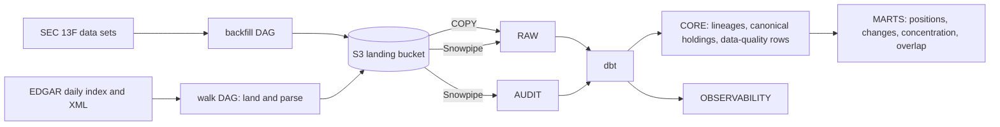

# EDGAR 13F Warehouse

A Snowflake warehouse that answers who holds what, and how institutional positions changed quarter over quarter, from SEC Form 13F filings. History comes from the SEC's own 13F data sets; every filing after them comes from a daily walk of EDGAR's index, parsed from XML, landed in S3 and loaded by Snowpipe. dbt resolves amendments once into canonical holdings and builds the marts from them.

The scope, every decision with its reason and date, and the checkpoints are in [docs/scope.md](docs/scope.md); the words the models and this README use are defined in [CONTEXT.md](CONTEXT.md).

**The trial ends before the November wave.** The Snowflake trial ends on 2026-11-08, before the mid-November wave of filings for 2026-09-30. The XML path is proven on late filers and amendments, up to 344 filings a day, and not on a wave day of about 2,600.

## Quickstart

**What it needs.** An AWS account with an admin profile, and a bucket name of your own. A Snowflake account; this one is a Standard trial in AWS us-east-1, the bucket's region. The [Astro CLI](https://www.astronomer.io/docs/astro/cli/overview) for Airflow, Terraform 1.5 or later, and [uv](https://docs.astral.sh/uv/), which brings Python 3.14 and every dependency. Three Snowflake key pairs, one each for Terraform, Airflow and dbt, encrypted with a real passphrase and kept outside the repository under `~/.snowflake/keys/`. The SEC asks automated clients to declare a contact address and stay under 10 requests a second: [Accessing EDGAR data](https://www.sec.gov/search-filings/edgar-search-assistance/accessing-edgar-data), [Form 13F data sets](https://www.sec.gov/data-research/sec-markets-data/form-13f-data-sets).

1. **Local checks**, what CI runs on every push:
   ```bash
   uv sync --all-groups
   uv run ruff check . && uv run ruff format --check .
   uv run pytest            # tests that call sec.gov are marked live; -m live runs them
   ```
2. **Snowflake structure.** Run `include/sql/00` to `08` in order in Snowsight. `00` puts the resource monitor and the X-Small warehouse in place before anything spends a credit. `01`, `05` and `07` create the three service users and take their public keys, and `03` and `08` create the tables the pipes load. Each file's header names what must run before it, and its last statements show whether it worked.
3. **Terraform**, from `terraform/`, then the rest of the SQL:
   ```bash
   cp terraform.tfvars.example terraform.tfvars     # bucket, owner, AWS profile, Snowflake account
   read -rs TF_VAR_snowflake_private_key_passphrase && export TF_VAR_snowflake_private_key_passphrase
   terraform init && terraform apply                # bucket, IAM, storage integration, stages, pipes, notification
   terraform plan                                   # should read: No changes
   ```
   Then `include/sql/09` to `11`: the audit records written before the pipes, LOADER's narrowed grants and the analyst role.
4. **Airflow.** Copy `.env.example` to `.env` and fill it in. Build the Snowflake line from the key, never by hand:
   ```bash
   uv run python -I scripts/snowflake_conn_line.py ~/.snowflake/keys/<airflow key>.p8 >> .env
   astro dev start
   ```
   `sec_datasets_backfill` runs once by hand and loads the 54 data sets, about half an hour on 2026-10-13. `edgar_daily_index_walk` runs daily at 06:00 UTC with catchup, so the scheduler walks a day the laptop slept through once it wakes. Never run anything with `uv run --env-file .env`. uv cannot parse the Snowflake line, and it prints the line, key and passphrase included. To use the data set command line, pass only the contact address: `AIRFLOW_VAR_EDGAR_CONTACT=<address> uv run python -m include.sec_cli list`.
5. **dbt.** The connection lives in `~/.dbt/profiles.yml`, outside the repository, with two targets: `dev`, the default, on the development clone, and `prod` on the warehouse.
   ```yaml
   edgar_13f_warehouse:
     target: dev
     outputs:
       dev:
         type: snowflake
         account: <organization>-<account>
         user: DBT_SVC
         role: TRANSFORMER
         warehouse: EDGAR_WH
         database: EDGAR_13F_DEV
         schema: CORE
         threads: 4
         private_key_path: ~/.snowflake/keys/<dbt key>.p8
         private_key_passphrase: "{{ env_var('DBT_SNOWFLAKE_PRIVATE_KEY_PASSPHRASE') }}"
       prod:
         type: snowflake
         account: <organization>-<account>
         user: DBT_SVC
         role: TRANSFORMER
         warehouse: EDGAR_WH
         database: EDGAR_13F
         schema: CORE
         threads: 4
         private_key_path: ~/.snowflake/keys/<dbt key>.p8
         private_key_passphrase: "{{ env_var('DBT_SNOWFLAKE_PRIVATE_KEY_PASSPHRASE') }}"
   ```
   From `dbt/`, `dbt build --target prod` builds and tests everything, about 12 minutes on the X-Small, and `dbt source freshness --target prod` says whether the walk and the pipes are current. To change a model, refresh the clone with `include/sql/12_dev_clone.sql`, run `dbt run --select config.materialized:view` so its views read the clone, then `dbt build --select <model>+`.
6. **Check it.** `select * from edgar_13f.observability.walk_days where not_loaded <> 0` lists the days the walk discovered more than loaded, and `select * from edgar_13f.observability.pipeline_freshness` how current each layer is. End every session with `show warehouses` reading `SUSPENDED`.

## 1. Why this architecture?



- **History comes from the SEC's data sets, and everything after from a daily walk of EDGAR's index.** The data sets are the SEC's own flattening of the 13F XML, so the history needs no parser of its own, and the walk begins where the last data set ends. The 54 data sets hold 124,012,468 holdings filed from April 2013 to August 2026; from 2026-08-31 to 2026-10-21 the walk found 2,562 filings, and all of them are in the warehouse. The five from its first day came in through the last data set, which ends that day.
- **S3 is the record, and the warehouse rebuilds from it.** Every byte from the SEC lands unchanged in a versioned bucket, under keys derived from what it is, so a rerun writes the same object again. The pipeline's IAM user may put, get and list and nothing else, and Snowflake reads through a role of its own that cannot write.
- **The XML is parsed in Python before it reaches Snowflake.** A parser with pydantic types the filer's XML where it enters and writes one JSON-lines file per filing beside it; a filing it cannot read goes into the run's audit record instead of loading in part. Nine filings failed this way from 2026-10-13 to 2026-10-19, and all nine loaded on 2026-10-22 from the XML already in S3 ([the record](docs/2026-10-22-cp5-parse-failure-recovery.md)).
- **Loading runs without hands.** A bucket notification tells Snowpipe of each new file, so a parsed filing reaches `RAW.PARSED_FILINGS` with nobody running anything, 52 seconds at the median from the S3 write to the commit ([the record](docs/2026-10-11-cp2-xml-path-proof.md)).
- **dbt resolves amendments once, into canonical holdings, and the marts read nothing else.** A filer's filings for one period form a lineage, and one model decides which of them contribute. 1,040 additions in the data sets resubmit a whole list; reading them as restatements took $26.5 trillion of double counting out. The result matches a separate pass over the 54 zips to the row, 115,478,173 data-set holdings. "What did Lone Pine Capital buy and sell last quarter" is one select on `position_changes`, and its 49 rows match the filings on sec.gov.
- **The pipeline records itself, and the warehouse reads the record.** Each attempt of a walk or a backfill writes an audit record to S3, a pipe loads it into `AUDIT`, and dbt derives `OBSERVABILITY` from `AUDIT`, `RAW` and `CORE`, so whether the pipeline is whole is a query.
- **Each layer has its own schema and each job its own role.** `RAW` holds the record as loaded, `CORE` the typed filings and canonical holdings, `MARTS` the question-shaped tables; LOADER adds rows to `RAW`, TRANSFORMER builds, TERRAFORM owns the plumbing and ANALYST reads `MARTS` alone ([the probes](docs/2026-10-23-cp5-rbac-proof.md)).
- **Every model rebuilds in full, and development runs in a clone.** A full build takes 11 to 12 minutes and about a fifth of a credit. One statement makes `EDGAR_13F_DEV`, a zero-copy clone that holds the whole warehouse for development ([the record](docs/2026-10-23-cp5-dev-clone.md)).

## 2. Why these technologies?

- **Snowflake, on an X-Small warehouse under a resource monitor.** The warehouse uses four Snowflake features: VARIANT for the parsed filings, Snowpipe, zero-copy clones and Time Travel. The trial's 150-credit monitor read 2.78 credits on 2026-10-23, after the backfill of 124 million holdings and every build from cp2 to cp5.
- **VARIANT for what the parser writes, text columns for the data sets.** The parsed filings load as JSON lines into one VARIANT column beside the file and line each came from, so a field the parser adds reaches `RAW` without a migration, and staging types it once. The data sets load into seven tables kept as text under the SEC's own column names, 125.9 million rows that reconcile with the cp1 profile to the row.
- **Snowpipe for the walk, bulk COPY for the backfill.** The walk lands a few hundred files on a busy day, which suits a pipe that loads each one as it arrives, 52 seconds at the median. The 54 data sets are one load, run and reconciled by hand; the largest table, INFOTABLE, took 4 minutes 7 seconds to COPY. Snowpipe is serverless and outside the resource monitor, so the account budget watches it.
- **S3 as the landing zone, versioned, in us-east-1 beside the Snowflake account.** Versioning keeps every overwritten object, and a filing's keys come from the filing itself, so a rerun shows up as a second version instead of a second file. One bucket notification serves all three pipes, each on its own prefix.
- **Airflow, run locally with the Astro CLI, for the walk and the backfill.** The walk is a daily schedule with catchup, so a day the laptop slept through is walked late instead of lost: the first scheduled run started at 10:50 UTC instead of 06:00 and walked its day. One pool slot and a client ceiling of 8 requests a second keep every EDGAR call under the SEC's 10; 20 sequential requests measured 7.9 a second. Airflow 3.3.1, on Astro Runtime 3.3-7.
- **dbt Core for every transformation and its tests.** The lineage rules, canonical holdings, marts and observability models are SQL with unit tests on fixtures and data tests on the built tables: 35 models, 162 data tests and 71 unit tests, all green in each full build on 2026-10-22. dbt 1.12.5 with dbt-snowflake 1.12.1.
- **Python with pydantic for the EDGAR client, the walk and the parser.** They are plain modules the DAGs call, tested without Airflow and with moto standing in for S3: 237 tests. pydantic types each holding where the filer's data enters, so a bad row fails with its index and field, as "row 1: name_of_issuer" did on 2026-10-19.
- **Terraform for the plumbing, numbered SQL for structure and access.** Terraform declares the bucket, the IAM identities, the storage integration, the stages, the pipes and the bucket notification, and a second plan reading "No changes" checks it. The database, schemas, tables, roles and grants are SQL files run in order, each naming what must come before it. The Snowflake provider is pinned at 2.21.0 because its pipe resource is still a preview.
- **uv, ruff and GitHub Actions for the repository.** uv pins Python 3.14 and every dependency, `requirements.txt` mirrors the runtime ones for the Astro image, and CI runs ruff and pytest on every push.

## 3. What are the failure modes?

Each failure below has happened, was forced on purpose, or has a named step against it. Two are recorded end to end as the failure demo: [parse failures, found and recovered](docs/2026-10-22-cp5-parse-failure-recovery.md), and [a bad build, undone with Time Travel](docs/2026-10-23-cp5-time-travel-recovery.md).

- **EDGAR refuses a request. The client retries briefly, the filing is recorded, and a rerun of its day lands it.** sec.gov answers an undeclared client with HTTP 403 and a page titled "Your Request Originates from an Undeclared Automated Tool", and limits an address that passes 10 requests a second until its rate "has dropped below the threshold for 10 minutes". It answers a missing file with 403 too, so the walk only asks for files the index lists. The client declares `edgar-13f-warehouse <contact>`, keeps to 8 requests a second, and tries five times over 15 seconds; a filing that still fails goes into the run's audit record and `walk_failures`. No landing has failed since the walk began.
- **A day goes unwalked. Catchup and a seven-day sweep fill it.** The laptop sleeps, so a run can start late, as the first scheduled one did at 10:50 UTC instead of 06:00. EDGAR also posts a daily index late now and then, two days late once in the first quarter walked, so each run lands any day of the last seven whose index is missing.
- **A filing is posted to a later day's index. It counts under its own filing date.** Two of the 2,562 filings were. `walk_days` reads one day a filing over and another a filing under, and the totals agree.
- **A filing will not parse. Nothing of it loads, the failure is recorded, and a rerun parses it once the parser can.** Nine did: eight notices the parser refused for carrying a summary page, and one holdings report with a blank issuer name. All nine loaded on 2026-10-22, eight by rerunning the parse from the XML in S3 and one after a parser fix.
- **A filing contradicts itself. It loads, and a data-quality row says so.** A summary page that disagrees with the table is a reconcile gap in the audit record and a `summary_disagrees_with_holdings` row in core, 75 walk filings and 52,849 data-set filings on 2026-10-21. Section 4 counts the other checks.
- **Snowpipe skips a path it has seen. Every file the pipes load is either new or the same bytes again.** A pipe ignores a path it processed in the last 14 days, even if the file changed. Parsed files have deterministic bytes, staging keeps one file version per filing, and each attempt's audit record has its own key: before 2026-10-21, seven walk records and one backfill record had been rewritten under one key.
- **A load fails inside Snowflake. The whole file stays out, and the walk's count shows it.** The pipes load with `ON_ERROR = SKIP_FILE`, so a filing arrives whole or not at all, and `walk_days` sets each day's index against what reached `CORE`. It reconciled 2,562 of 2,562 on 2026-10-22, so no file has.
- **A bad build replaces a table. Time Travel brings the old one back within a day, and dbt rebuilds it after that.** dbt replaces tables, so the old one sits in Time Travel under a name that now means a new object. A rename and an `UNDROP` restored the clone's `filer_overlaps` twelve minutes after a build broke it, row for row what production holds.
- **Someone resumes a cloned pipe. The clone has none.** A cloned auto-ingest pipe starts stopped, and once resumed it would load production a second time, because its COPY names production's table in full. `12_dev_clone.sql` drops all three.
- **Spending runs away. The monitor stops the warehouse.** The warehouse is X-Small with a 60-second auto-suspend, under a 150-credit monitor that notifies at 50 and 80 percent and suspends at 90. Snowpipe is outside the monitor's reach, so the account budget watches it. Every session ends with `show warehouses` as ACCOUNTADMIN, because a role without the warehouse does not see it, and the `running` column can read 1 on a suspended warehouse.
- **A key leaks. It opens one role, and it expires with the trial.** Each service user has its own key pair, restricted to one role, so a leaked key reaches only that role's work, and the three keys expire on 2026-11-08. `uv run --env-file .env` prints the Snowflake connection line in full, so nothing in the project runs that way.
- **The trial ends. S3 keeps everything.** The Snowflake account goes on 2026-11-08. The walk needs no Snowflake to land and audit, and the bucket holds every byte the warehouse was built from.

## 4. How is data quality measured?

- **What the rules resolve without the source settling it becomes a data-quality row, and no row stops a build.** Sixteen checks write one row per filing and check into `CORE.DATA_QUALITY_ROWS`, and `OBSERVABILITY.DATA_QUALITY_CHECK_COUNTS` counts them. On 2026-10-21 the largest were 52,849 data-set filings whose summary page disagrees with their table, 13,499 whose value unit the filing date would have read wrong, and 1,040 additions read as restatements. The marts flag those filings and never drop them, because a share, a weight or an overlap is a ratio within one filer's period, and a unit error across a filing leaves it unchanged.
- **The counts are checked against a separate pass over the 54 zips.** A Python pass that reads the zips one at a time computes the data-set count of thirteen of the sixteen checks on its own, and `data_quality_counts_match_the_lineage_profile` fails if the SQL disagrees. The same pass left 115,478,173 data-set canonical holdings, and `row_counts_meet_the_zip_pass` holds the warehouse to it: 115,413,519 canonical holdings and 64,654 that walk restatements set aside on 2026-10-21.
- **Canonical holdings are checked against the filings themselves.** Eight lineages of six filers are pinned by rows and dollars per contributing filing, Brookfield and Advisors Asset Management from the zip pass and Morgan Stanley, Deutsche Bank, Janus Henderson and Prudential from their filings on sec.gov. Lone Pine Capital's 49 position changes for 2026-06-30 match a reading of its two filings on sec.gov, and six of them were checked by hand on the filing pages.
- **Every load reconciles row for row.** For each of the seven data set tables, the rows the backfill extracted, the rows its COPY loaded and the rows in `RAW` are the same number, 124,012,468 in INFOTABLE; every raw holding row reaches `CORE` on both paths; and every filing the walk discovered is in `CORE`.
- **Each rule was a failing test before it was code, and broken on purpose after.** The 71 unit tests pin the lineage rules, the dimensions, the marts and the observability models on small fixtures, and each was red before green. Breaking a rule on purpose then had to fail its own test: sixteen breaks of the marts in cp4 and twelve of the observability models in cp5 each did.
- **Value units are read per filing, not by the filing date alone.** The SEC moved values to dollars on 2023-01-03, but 112 of 327 restatements filed after it for earlier periods still report in thousands. A filing's median value per share decides its unit, which the restatements whose originals settle the question confirm in 315 of 316 cases, and a second check flags a filing whose prices sit a hundred times or more off the median of every filer holding the same security that period.

### Identifier limits

- **CUSIP is the only key before 2023, and not every CUSIP can be trusted.** 21,222 CUSIPs behind 193,191 holdings are not nine well-formed characters, and 35,640 of the 129,503 well-formed ones fail the check digit, from 29 to 36 percent of each data set's well-formed CUSIPs after the first, or 1.15 percent of the well-formed rows. `securities` marks both with `is_well_formed` and `has_valid_check_digit` and drops neither. The placeholder `000000000` passes both checks; it stood for 6,359 holdings in the profile of 2026-10-19.
- **FIGI arrives in 2023, on a minority of rows, and filers disagree on it.** FIGI appears on 7 to 12 percent of rows from 2023 and never before. 9,879 of the 24,067 CUSIPs that carry one carry several, and 6,486 FIGIs name more than one CUSIP, so a security takes a FIGI only where its filers report exactly one.
- **No CUSIP is mapped to a ticker.** The mapping is proprietary, so the warehouse names a security by the issuer name and class its filers most often gave it in its last period.
- **A changed CUSIP reads as an exit and an entry, and a split as an increase.** A 13F lists holdings, not trades. When a corporate action changes a security's CUSIP, the filer exits one position and enters another, as Skillsoft did after the reverse split Morgan Stanley's amendment for 2024-03-31 names. An increase in shares may be a purchase or a split.
- **Periods and filing dates, not positions in real time.** A holding is what a filer reported for a quarter's end, up to 45 days later or, through amendments, years later. `position_changes` compares a period with the one before, never a date with a date.
