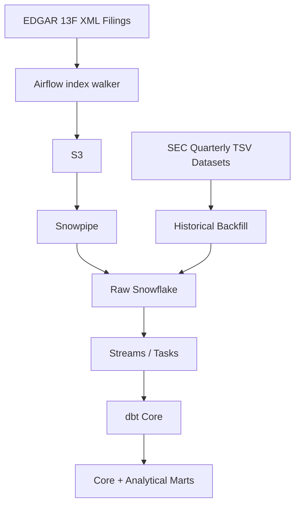

# Project 2: SEC EDGAR 13F Warehouse

## Goal

Build a Snowflake warehouse answering:

> **Who holds what, and how did institutional positions change quarter-over-quarter?**

This is the flagship project because it combines a realistic domain, semi-structured data, incremental ingestion, warehouse modeling and difficult data-quality rules.

**Snowflake timing constraint:** activate the Snowflake trial only when Steam is complete and EDGAR is ready to enter its Snowflake phase. The trial ends after 30 days **or** when the free credit balance is exhausted, whichever comes first, so the implementation must fit inside that window and careless compute can end it early. From day one: X-Small warehouse, aggressive auto-suspend, and a resource monitor capping credit consumption.

## Tech stack

| Layer                   | Technology                                     |
| ----------------------- | ---------------------------------------------- |
| Historical source       | SEC 13F structured datasets (TSV, first-party) |
| Incremental source      | EDGAR 13F XML filings                          |
| Orchestration           | Apache Airflow (Astro CLI, local)              |
| Landing                 | S3                                             |
| Ingestion               | Snowpipe auto-ingest                           |
| Warehouse               | Snowflake                                      |
| Semi-structured storage | VARIANT                                        |
| Incremental processing  | Streams & Tasks                                |
| Transformation          | dbt Core                                       |
| CI                      | GitHub Actions                                 |

### Architecture

## Historical vs incremental ingestion

### Historical backfill: TSV only

**Do not build a historical XML parser.**

The SEC publishes first-party 13F datasets that are extracted from the XML-based portions of EDGAR submissions and provided in flattened form. They already cover the historical data needed for the warehouse.

Reasoning:

- the TSV data is an official SEC representation of the structured filing data
- historical XML parsing adds large amounts of edge-case work with little additional portfolio signal
- the project needs historical volume, not an archaeological reconstruction of every filing
- time is better spent on amendment resolution, tests, incremental processing and warehouse design

The project therefore treats the TSV datasets as the **correct historical ingestion path**, not a shortcut or fallback.

### Incremental ingestion: XML

Use raw 13F XML for newly discovered filings.

This still proves the ability to:

- retrieve and store semi-structured source data
- parse XML into typed records
- handle malformed/unexpected structures
- process amendments
- incrementally update the warehouse

No time should be spent making the XML path reproduce the entire historical dataset.

## Modeling

Use a normalized core layer where it solves a real problem, then build dimensional marts. The core exists to resolve amendments and supersedence once, producing a canonical holdings state that multiple downstream marts can consume.

Core:

- `filer`
- `security`
- `filing`
- `period`
- canonical amendment / supersedence state
- `holding`

Marts:

- portfolio evolution
- new positions / exits
- concentration metrics
- institutional portfolio overlap

## Key engineering problem: amendments

13F amendments are the project's main data-correctness challenge.

The pipeline must distinguish original filings from amendments and resolve the canonical state before downstream marts consume it.

This is a stronger engineering showcase than simply demonstrating that XML can be parsed.

## Data quality

Examples:

- holding quantity and value constraints
- unique filing lineage
- amendment supersedence tests
- duplicate detection
- unit normalization across historical periods
- reconciliation between raw and canonical record counts

## Observability

Track:

- filings discovered vs loaded
- ingestion failures
- XML parsing failures
- amendment resolution failures
- duplicate/superseded filings
- raw-to-modeled row counts
- pipeline freshness

## Domain constraints

- respect EDGAR's published maximum of 10 requests/second and declare a meaningful `User-Agent` containing contact information
- do not scrape proprietary CUSIP→ticker mappings
- make identifier limitations explicit in the README
- frame analytics around filing dates and reporting periods, not real-time positions

## Snowflake features to use deliberately

Use platform features because they solve a problem:

- **VARIANT** for raw semi-structured records
- **Snowpipe** for incremental ingestion
- **Streams & Tasks** for incremental state changes
- **dbt incremental models/snapshots** where appropriate
- **Time Travel** for recovery/debugging
- **Zero-copy cloning** for a development environment
- **RBAC** to separate ingestion/transformation/analytics responsibilities

Do not add features merely to increase the technology checklist.

## Checkpoints

1. **Extraction proven, trial untouched** (`cp1-extraction`). Everything runs locally so the 30-day clock is not burning. The index walker discovers filings and downloads XML at polite rates with the declared `User-Agent`; the parser produces typed records; the TSV historical datasets are downloaded and profiled with row counts written down. Done when the parser handles representative real filings plus deliberately crafted malformed fixtures. Fixtures are built, not hunted: real malformed filings will appear during operation anyway.

2. **Snowflake ingests without hands** (`cp2-snowpipe`). Trial activated; resource monitor set the same hour. Terraform applies the stage, pipe and notification wiring; the TSV backfill is loaded. Done when a new XML file dropped in S3 appears in the VARIANT raw table with no manual step, and backfill row counts reconcile against the checkpoint 1 profile. Revised 2026-10-13: with the parser in Python, the walk run that lands a filing's XML also parses it, and the JSON-lines file it writes to S3 is what Snowpipe loads with no manual step.

3. **Canonical holdings are correct** (`cp3-canonical`). The intellectual center of the project. Core layer built, supersedence state working, restatement-versus-addition logic tested. Done when a hand-picked filer with a known messy amendment history shows correct canonical holdings, and the supersedence and lineage dbt tests are green.

4. **Warehouse answers questions** (`cp4-marts`). QoQ marts live: portfolio evolution, entries and exits, concentration, overlap. Done when "what did filer X buy and sell last quarter" is one query, and the answer matches a manual spot-check against the actual filing on EDGAR's website. The external oracle matters: here is what the source says, here is what my system says.

5. **Platform is operable and recoverable** (`cp5-operability`). The purpose is operability, not feature box-checking; the features are the evidence. RBAC as operational separation, zero-copy clone as the development workflow, one recorded Time Travel recovery, audit tables populated, README done. Done when the failure demo exists as a script or recording and the README answers all eight questions.

## Stretch ideas

Alternative identifier enrichment, additional marts, or deeper Snowflake experiments may be added only after the core warehouse is correct, tested and documented.

## What this project proves

> I can design a warehouse around messy public data, separate historical backfill from operational incremental ingestion, resolve difficult data-correctness problems, and use Snowflake/dbt features for clear architectural reasons.

## Decisions

Settled 2026-09-23 at the start of cp1. Each carries a reason and a fact that can be checked. Revisions are made in place with their date.

- **Repository `edgar-13f-warehouse`, dbt project `edgar_13f_warehouse`, Snowflake database `EDGAR_13F`.** Same pattern as `steam-player-analytics`: source first, then what the thing is, kebab-case, no technology names. Rejected: `sec-edgar-13f-warehouse` says SEC twice, `sec-13f-warehouse` drops the specific name, `institutional-holdings-warehouse` describes the question and hides the source.
- **Airflow schedules the index walker and the XML downloader: daily, `catchup=True`, `max_active_runs=1`.** EDGAR keeps every daily index file under `Archives/edgar/daily-index/`, so a day missed with the laptop off is backfilled by the next run. 13F filings arrive in waves 45 days after quarter end, so daily polling is enough. GitHub Actions on a cron was considered and set aside: it gains freshness while the laptop is closed and loses run-level observability. GitHub Actions stays for CI.
- **Packaging: uv, `requires-python == 3.14.*`, ruff `>=0.16` at line length 100.** `requirements.txt` is what the Astro Runtime image installs; `pyproject.toml` mirrors it for the IDE and tests. Runtime 3.3-7 ships Airflow 3.3.1 and neither the amazon nor the snowflake provider, so both are pinned in `requirements.txt`. Ruff 0.16 grew the default rule set from 59 to 413 rules; the floor keeps that from moving under `uv sync`.
- **Terraform manages S3 and the Snowflake stage, pipe and notification wiring. RBAC is numbered SQL under `include/sql/`.** Roles are the operability story of cp5 and read better as scripts run in order than as provider resources bound to local state. State is local; remote state is a "what would change in production" line. Revised 2026-10-10: the line runs between structure and plumbing. Numbered SQL creates the database, schemas, roles, grants and tables; Terraform creates the storage integration, file format, stage, pipe and bucket notification. `snowflake_table` is a preview resource in provider 2.21.0. Revised 2026-10-13: the file formats live inline in their stages, so Terraform creates no file format object.
- **The cp3 test filer is Brookfield Corp /ON/, CIK 0001001085, period 2018-06-30.** Chosen 2026-10-08 from the data set profile and checked against EDGAR: an original of 191 holdings, a RESTATEMENT of two rows that formally replaces the report, a full RESTATEMENT the next day, then a NEW HOLDINGS of one row. Period 2017-12-31 is the second case; Advisors Asset Management, CIK 0001297376, is the tidy control.
- **Candidates are ranked by periods with two or more holdings-report amendments**, with a bonus for filers that use both amendment types and a floor and cap on table size (50 to 3,000 rows) so a period can be checked by hand. Decided 2026-10-07 when the profile ran; the earlier wording, "where AMENDMENTTYPE takes both values", was the intent and this is the method.
- **The XML walk starts on 2026-09-01**, the day after the last data set available when the walk was built (01jun2026-31aug2026) ended. The start date stays fixed when the next data set is published; the overlap becomes a reconciliation test between the two paths.
- **A late-posted daily index is swept, not lost.** Each run also lists the last seven days and lands any listed day whose index is not in S3. Decided 2026-10-01 after one index in the quarter listing was posted two days late. Part of the catchup decision above.
- **Data set zips stay on the laptop in cp1**, under gitignored `data/datasets/`, profiled from there. The cp2 backfill lands them in S3 before loading; until then they are the one input not in the landing zone. Recorded 2026-10-08.
- **One Airflow pool, `edgar`, one slot and a client ceiling of 8 requests per second.** The SEC limit is 10 per second per client and Airflow runs tasks in parallel. One slot serializes every EDGAR-calling task so a single limiter in the client governs the rate.
- **User-Agent `edgar-13f-warehouse <contact email>`.** The SEC's sample header is a name followed by a contact address. The address comes from the Airflow Variable `EDGAR_CONTACT`.
- **The Snowflake trial started on 2026-10-09 with $400 and ends on 2026-11-08 or when the balance runs out; the project runs in `JOPUFPW-EDGAR_13F`, Standard, AWS US East (N. Virginia).** The free signup offered neither edition nor region and placed the first account in São Paulo on Enterprise; only the CoCo signup offered a region, and it bills warehouses at on-demand rates. The first account holds ORGADMIN, which created `EDGAR_13F` next to the bucket. The trial closes before the mid-November 13F wave, so the XML path is proven on the daily trickle of late filers and amendments.
- **A second account in the bucket's region, on Standard, instead of the São Paulo Enterprise account.** The pricing guide lists Standard in N. Virginia at $2.00 a credit and Enterprise in São Paulo at $4.65, so the balance is about 200 credits instead of 86. Standard covers every feature in this scope: Snowpipe, streams, tasks, cloning and Time Travel up to one day, so the cp5 recovery runs within a day of the change it undoes. Loading across regions would have worked, since Snowflake creates the pipe's SQS queue in the bucket's region, but the price and a warehouse beside its data decided it. The São Paulo account stays as the ORGADMIN account behind a 1-credit monitor: an organization administrator cannot drop the account they are logged in to, and nothing documents what dropping the signup account does to the trial.
- **No backfill until the billing view shows `EDGAR_13F` drawing on the trial balance.** The new account's banner reads "Trial ends in 30 days" but shows no balance, and no card is on file. `SNOWFLAKE.ORGANIZATION_USAGE.USAGE_IN_CURRENCY_DAILY.BALANCE_SOURCE` names the funds behind each account's daily usage, with up to 72 hours of latency. Terraform and DDL go ahead in the meantime. Passed 2026-10-12: the view reads `Free Usage` for `EDGAR_13F` on every day from 2026-10-09, so the second account draws on the trial balance.
- **A resource monitor caps warehouse credits; the account budget watches serverless spend.** Snowflake's resource monitor docs say monitors work for warehouses only, and Snowpipe is serverless. `include/sql/00_cost_guard.sql` creates `EDGAR_TRIAL_MONITOR` at 150 credits ($300) with `FREQUENCY = NEVER`, since the default monthly reset would refill it on 1 November, and `EDGAR_WH` at X-Small, Gen1, 60 seconds auto-suspend. On 2026-10-09 `SHOW WAREHOUSES` lists `EDGAR_WH` and the provisioned `SYSTEM$STREAMLIT_NOTEBOOK_WH`, both under the monitor. The account budget, `SNOWFLAKE.LOCAL.ACCOUNT_ROOT_BUDGET`, has a 180-credit monthly limit and emails when projected spending passes half of it. Every session ends with `SHOW WAREHOUSES` reading `SUSPENDED` on each row.
- **Terraform logs in as `TERRAFORM_SVC`, a SERVICE user, with a named key pair limited to the `TERRAFORM` role.** A SERVICE user cannot log in with a password or enroll in MFA, so the key is the only way in. `ROLE_RESTRICTION = 'TERRAFORM'` makes the key useless with any other role, and `DAYS_TO_EXPIRY = 30` ends it with the trial on 2026-11-08. The private key is AES-256 encrypted under `~/.snowflake/keys/`, outside the repository and the Astro build context. Airflow and dbt get their own users and keys, so each can be revoked alone. `include/sql/01_terraform_identity.sql`; on 2026-10-09 the fingerprint Snowflake registered matched the local key.
- **Snowflake reads the landing bucket through one read-only IAM role, `edgar-13f-warehouse-snowflake`, behind the storage integration `EDGAR_LANDING`.** The role holds Snowflake's documented read-only loading set (`GetObject`, `GetObjectVersion`, `ListBucket`, `GetBucketLocation`), so the landing zone stays append-only for its reader as for its writer. The integration allows the whole bucket, which holds nothing but this pipeline's data; each stage narrows to its own prefix. On 2026-10-10 `SYSTEM$VALIDATE_STORAGE_INTEGRATION` returned success for read and list and failure for write.
- **The XML parser runs in Python before Snowflake: `include/edgar_xml.py` writes JSON lines under `parsed/`, and Snowpipe loads them into a VARIANT raw table.** The parser and its tests exist from cp1, pydantic sits where filer-authored data enters, and a parse failure or a `reconcile` gap becomes an audit row before anything loads. Revised 2026-10-13: a filing that fails to parse writes no file and is recorded in the run's audit record in S3; a `reconcile` gap is recorded there too, but its file loads, as the layout bullet below says. The XML itself stays under `raw/edgar/filings/`, so the warehouse can be rebuilt from it. Rejected: loading the XML into VARIANT and parsing it with Snowflake's XML functions, which moves filer-chosen namespaces and validation into SQL after the load. Decided 2026-10-10.
- **One JSON-lines file per filing, `parsed/edgar/filings/filed=YYYY-MM-DD/<accession>.jsonl`, loaded into `RAW.PARSED_FILINGS`.** The cover page is the first line and each holding follows, each wrapped as `{record_type, accession, source_key, record}`, so a filing reaches the warehouse whole or not at all and every row names the XML it came from. Keys and bytes are deterministic, like the raw XML: Snowpipe ignores a path it processed in the last 14 days even if the file changed, and the walk re-lands only the last 7 days, so a rerun never loads twice. A filing that fails to parse writes no file; the failure and any `reconcile` gap go into the run's audit record. Load time is the table's row timestamp, because the pipe docs say a `CURRENT_TIMESTAMP` default records when the load compiles, not when it commits. Decided 2026-10-11.
- **The data set zips land as fetched under `raw/sec/datasets/`; their tables are re-compressed one file per table and zip under `extracted/sec/datasets/table=<TABLE>/<data set>.tsv.gz` and loaded by COPY into seven text tables, `RAW.DATASET_<TABLE>`.** Snowflake's file formats read gzip and not zip, so the zip stays the raw record and the gzip copy is what loads. The gzip header carries no timestamp, so a rerun writes the same bytes, and bulk COPY skips a file it loaded in the last 64 days. Each table has one header in all 54 zips, so each raw table is one fixed column list, kept as text with the data sets' own names. A scan of all 125.9 million rows on 2026-10-11 found no column-count mismatch, no CRLF and no invalid UTF-8, but 4,100 rows with a backslash and 7,907 with a double quote, so the TSV format sets `ESCAPE_UNENCLOSED_FIELD = NONE` (the default backslash would read them as escapes, and a trailing one joins two rows) and leaves `FIELD_OPTIONALLY_ENCLOSED_BY` at its default `NONE`. The largest file, `INFOTABLE` of 01jun2026-31aug2026, is 397 MB uncompressed, inside Snowflake's guidance of 100 to 250 MB compressed per file. Decided 2026-10-11.
- **Airflow logs in to Snowflake as `AIRFLOW_SVC`, a SERVICE user in `LOADER`, with its own key pair restricted to that role.** Terraform's key cannot load data and this one cannot create objects, so either can be revoked alone. Revised 2026-10-13: Terraform's role holds SELECT and INSERT only on `RAW.PARSED_FILINGS`, which its pipe loads with the owner's privileges, and no warehouse; `include/sql/06_narrow_terraform_grants.sql` took back the wider grant `02` first gave. The connection lives in `.env` as `AIRFLOW_CONN_SNOWFLAKE_DEFAULT`, beside the AWS connection, because `~/.snowflake/keys/` is not mounted into the Astro containers: the encrypted key goes in base64 under `private_key_content` and its passphrase in the password field, which the Snowflake hook uses to decrypt the key and then drops before connecting. `.env` is the trust boundary for both connections. `scripts/snowflake_conn_line.py` builds the line from the key and refuses a passphrase that does not open it. The key expires with the trial on 2026-11-08. `include/sql/05_airflow_identity.sql`.
- **dbt logs in as `DBT_SVC`, a SERVICE user in `TRANSFORMER`, with the third key pair, restricted to that role.** `TRANSFORMER` reads `RAW` and `AUDIT` and creates tables and views in `CORE` and `MARTS`; it holds no INSERT on the raw schemas, so a model cannot write back to the loaded record, and `SYSADMIN` owns the two new schemas as it owns the first two, so dbt can replace what is inside them and cannot drop them. The connection is `~/.dbt/profiles.yml`, outside the repository, naming the key by path and reading its passphrase from `DBT_SNOWFLAKE_PRIVATE_KEY_PASSPHRASE`, so neither the file nor the repository holds a secret. The key expires with the trial on 2026-11-08. `include/sql/07_dbt_identity.sql`. Decided 2026-10-15.
- **Filing order within a lineage is filing date, then accession number.** The amendment number on the cover page is assigned by the filer, so it is recorded and not trusted for order, and the SEC's 13F FAQ (58b) says only that the filer numbers amendments to tell them apart. The data sets carry the filing date of every submission, and the accession number's last segment is the filing agent's sequence within the year. Two filings of one lineage on one date, which Brookfield's two restatements of November 2018 avoid by a day, get a data-quality row. Decided 2026-10-15; the terms are in `CONTEXT.md`. Revised 2026-10-16: the SEC's Accessing EDGAR Data page defines the first ten digits as the CIK of the entity submitting the filing and the last six as "a sequential count of submitted filings from that CIK", so filings of one date under one prefix are in submission order, and only filings of one date from different submitters get a data-quality row. A local profile of the 54 data sets found 1,120 lineages where accession order within a date picks the effective restatement, 22 of them across submitters.
- **A restatement supersedes every holdings report before it in the lineage, an addition supersedes nothing, and canonical holdings are the holdings of the contributing filings: the latest restatement, or the original when none exists, plus every addition after it.** FAQ 58b: an amendment that corrects an error must resubmit the entire filing as corrected. FAQ 58c: an amendment adding new holdings lists only the securities being added and supplements the original. Check: Brookfield Corp /ON/, period 2018-06-30, resolves to the 191 holdings of the restatement of 2018-11-15 plus the one holding added on 2018-12-14, with the original and the two-row restatement of 2018-11-14 superseded. Decided 2026-10-15. Revised 2026-10-16: 228 lineages in the data sets have an addition filed before a later restatement, which this rule supersedes; a data-quality row records each superseded addition whose securities the restatement does not list, so the rule is checked against the holdings.
- **A filing the rules cannot read as filed counts as a restatement and gets a data-quality row: an untyped amendment, of which the data sets hold 55, and a second original for the same period. An addition that repeats a security already in effect keeps both holdings, flagged. A lineage that starts with an amendment stands on the filings present, flagged.** The FAQ's procedure resubmits the whole filing unless the cover page's new-holdings box is checked, so an unchecked box reads as the base case rather than a guess from entry counts. Merging a repeated security would invent a value the filer never reported, and one security may appear in several holdings of one filing by discretion or other manager. The data sets begin with filings of April 2013, so lineages for earlier periods start mid-chain. Decided 2026-10-15. Revised 2026-10-16: the count of untyped amendments was 14 until the lineage profile, which found 53 to holdings reports in 52 lineages and 2 to notices; the cp1 profile had subtracted the typed filings of every submission type from the amendments. The same profile found 421 lineages that start with an amendment: 262 for periods before 2013, 50 in the first data set, 109 for later periods whose original is absent.
- **Notices join the lineage and never supersede holdings; a notice amendment amends a notice. The canonical state is the current one, and an as-known-on-date view is a cp4 mart if one is wanted.** A notice says another manager reports the holdings and carries none, so it changes nothing about what is in effect. Consequence: the two 13F-NT filings with a summary page that the parser refused on 2026-10-14 (`0001758171-26-000005`, `0001510483-26-000007`) are notices with extra data, so the parser's rule that a notice has no summary page is relaxed in cp3 and they load. Decided 2026-10-15.
- **A lineage is one filer's filings for one period of report, the period EDGAR records with the submission. Where the submission type and the cover disagree, the submission type decides whether a filing is an original, an amendment or a notice, the cover's amendment type decides restatement or addition, and the disagreement gets a data-quality row.** The XML parser reads the period from the same header field the data sets carry as `PERIODOFREPORT`; the cover's own period differs in 5 filings, one of them 1900-01-01 and one the filing date. The cover's amendment box disagrees with the submission type in 93 filings: 41 typed 13F-HR name an amendment type, 11 typed 13F-NT call themselves holdings or combination reports and have no summary page, and the rest are untyped amendments. Reading the cover's amendment type first instead changes the contributing filings of none of the 307,613 holdings-report lineages, so the rule follows EDGAR's record and keeps the cover as evidence. Decided 2026-10-16.
- **Staging is eleven views in `CORE`, one per raw data set table and four over the XML envelope, with the data set conventions written once as macros.** A view costs nothing until it is read and the core tables materialize from them, so the typing happens in one named place: blank to null, `DD-MON-YYYY` to date, Y and N to boolean, and VALUE and TABLEVALUETOTAL times 1,000 when the filing date is before 2023-01-03, the SEC readme's rule applied by filing date, which is why the holdings and summary views join the submission. The two paths share column names, so the core layer sets them side by side, and both keep their own row identity, `INFOTABLE_SK` and the XML `row_index`, for lineage. The XML envelope keeps one file version per filing, the one written last, because Snowpipe loads a path again after 14 days. Checks: three dbt unit tests, for the unit rule and the other-manager field, the flags and dates, and the dedupe; a pytest that finds every raw column name from `sec_backfill` in the staging SQL. Decided 2026-10-16.
- **The supersedence state is one model, `lineage_filings`: every filing with its position in its lineage, its role, and whether it is superseded or contributing. Nine dbt unit tests pin the rules, and data tests check the state of every lineage.** The model is plain SQL, so its unit tests ran in a local DuckDB copy outside the repository before the Snowflake run, one rule at a time, each red before green. Four rules already held when their tests arrived; breaking the model four ways, by reversing the accession order, by never superseding additions, by reading an untyped amendment as an addition and by keying lineages on the filer alone, failed exactly the matching test each time. The data tests: one filing per lineage position, every filing in a lineage, exactly one effective filing in a lineage with an original or a restatement, no superseded filing contributing, notices doing neither, every addition after the effective filing contributing, and Brookfield's lineage for 2018-06-30 as filed. Decided 2026-10-16.

## Source facts

Checked against sec.gov on 2026-09-23 with the project User-Agent. Re-check before relying on them in a later checkpoint.

- **Dataset zips are cut by filing date, not reporting period.** 54 files, windows from 2013-04-01 to 2026-08-31, the SEC page labels them July 2013 to August 2026, 3.05 GB compressed. Older names look like `2013q2_form13f.zip`, newer ones like `01jun2026-31aug2026_form13f.zip`. A zip holds filings submitted in its window, cutoff 5:30 PM Eastern on the quarter's last business day. One period spans many zips through late filers and amendments, so cp2 reconciles per zip and the period dimension comes from PERIODOFREPORT. A COVERPAGE row in the June to August 2026 zip reports period 30-SEP-2001.
- **VALUE changed units on 2023-01-03.** From the SEC readme inside each zip: "Starting on January 3, 2023, market value is reported rounded to the nearest dollar. Previously, market value was reported in thousands." This is the unit normalization rule. The boundary is verified during cp1 profiling.
- **INFOTABLE carries a nullable FIGI next to CUSIP.** Filing 0001535452-26-000006 populated it on all 393 rows, 0001214659-26-011877 on none. FIGI is an open identifier, so enrichment through OpenFIGI is the strech path that respects the no-CUSIP-scraping rule. Before 2023, CUSIP is the only key.
- **The info table XML has no fixed name.** Every filing folder has `primary_doc.xml` plus one info table file named by the filer, `infotable.xml` in one filing and `AP2ReportQ22026.xml` in another. The downloader reads the folder's `index.json` instead of guessing.
- **Observed rate.** 20 sequential requests at 7.9 per second, all 200, no 429 or 403. The policy page reads "Current max request rate: 10 requests/second."
