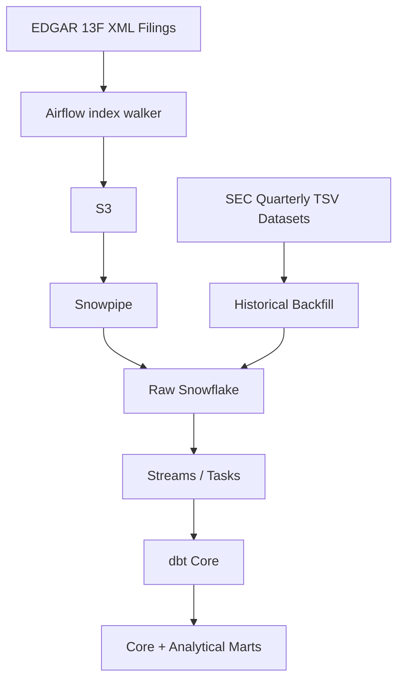

# Project 2: SEC EDGAR 13F Warehouse

## Goal

Build a Snowflake warehouse answering:

> **Who holds what, and how did institutional positions change quarter-over-quarter?**

This is the flagship project because it combines a realistic domain, semi-structured data, incremental ingestion, warehouse modeling and difficult data-quality rules.

**Snowflake timing constraint:** activate the Snowflake trial only when Steam is complete and EDGAR is ready to enter its Snowflake phase. The trial ends after 30 days **or** when the free credit balance is exhausted, whichever comes first, so the implementation must fit inside that window and careless compute can end it early. From day one: X-Small warehouse, aggressive auto-suspend, and a resource monitor capping credit consumption.

## Tech stack

| Layer                   | Technology                                     |
| ----------------------- | ---------------------------------------------- |
| Historical source       | SEC 13F structured datasets (TSV, first-party) |
| Incremental source      | EDGAR 13F XML filings                          |
| Orchestration           | Apache Airflow (Astro CLI, local)              |
| Landing                 | S3                                             |
| Ingestion               | Snowpipe auto-ingest                           |
| Warehouse               | Snowflake                                      |
| Semi-structured storage | VARIANT                                        |
| Incremental processing  | Streams & Tasks                                |
| Transformation          | dbt Core                                       |
| CI                      | GitHub Actions                                 |

### Architecture

## Historical vs incremental ingestion

### Historical backfill: TSV only

**Do not build a historical XML parser.**

The SEC publishes first-party 13F datasets that are extracted from the XML-based portions of EDGAR submissions and provided in flattened form. They already cover the historical data needed for the warehouse.

Reasoning:

- the TSV data is an official SEC representation of the structured filing data
- historical XML parsing adds large amounts of edge-case work with little additional portfolio signal
- the project needs historical volume, not an archaeological reconstruction of every filing
- time is better spent on amendment resolution, tests, incremental processing and warehouse design

The project therefore treats the TSV datasets as the **correct historical ingestion path**, not a shortcut or fallback.

### Incremental ingestion: XML

Use raw 13F XML for newly discovered filings.

This still proves the ability to:

- retrieve and store semi-structured source data
- parse XML into typed records
- handle malformed/unexpected structures
- process amendments
- incrementally update the warehouse

No time should be spent making the XML path reproduce the entire historical dataset.

## Modeling

Use a normalized core layer where it solves a real problem, then build dimensional marts. The core exists to resolve amendments and supersedence once, producing a canonical holdings state that multiple downstream marts can consume. Revised 2026-10-19: cp3 builds the filing, the lineage with its supersedence state, holdings and canonical holdings; filer, security and period are built in cp4 with the marts that read them.

Core:

- `filer`
- `security`
- `filing`
- `period`
- canonical amendment / supersedence state
- `holding`

Marts:

- portfolio evolution
- new positions / exits
- concentration metrics
- institutional portfolio overlap

## Key engineering problem: amendments

13F amendments are the project's main data-correctness challenge.

The pipeline must distinguish original filings from amendments and resolve the canonical state before downstream marts consume it.

This is a stronger engineering showcase than simply demonstrating that XML can be parsed.

## Data quality

Examples:

- holding quantity and value constraints
- unique filing lineage
- amendment supersedence tests
- duplicate detection
- unit normalization across historical periods
- reconciliation between raw and canonical record counts

## Observability

Track:

- filings discovered vs loaded
- ingestion failures
- XML parsing failures
- amendment resolution failures
- duplicate/superseded filings
- raw-to-modeled row counts
- pipeline freshness

## Domain constraints

- respect EDGAR's published maximum of 10 requests/second and declare a meaningful `User-Agent` containing contact information
- do not scrape proprietary CUSIP→ticker mappings
- make identifier limitations explicit in the README
- frame analytics around filing dates and reporting periods, not real-time positions

## Snowflake features to use deliberately

Use platform features because they solve a problem:

- **VARIANT** for raw semi-structured records
- **Snowpipe** for incremental ingestion
- **Streams & Tasks** for incremental state changes
- **dbt incremental models/snapshots** where appropriate
- **Time Travel** for recovery/debugging
- **Zero-copy cloning** for a development environment
- **RBAC** to separate ingestion/transformation/analytics responsibilities

Do not add features merely to increase the technology checklist.

## Checkpoints

1. **Extraction proven, trial untouched** (`cp1-extraction`). Everything runs locally so the 30-day clock is not burning. The index walker discovers filings and downloads XML at polite rates with the declared `User-Agent`; the parser produces typed records; the TSV historical datasets are downloaded and profiled with row counts written down. Done when the parser handles representative real filings plus deliberately crafted malformed fixtures. Fixtures are built, not hunted: real malformed filings will appear during operation anyway.

2. **Snowflake ingests without hands** (`cp2-snowpipe`). Trial activated; resource monitor set the same hour. Terraform applies the stage, pipe and notification wiring; the TSV backfill is loaded. Done when a new XML file dropped in S3 appears in the VARIANT raw table with no manual step, and backfill row counts reconcile against the checkpoint 1 profile. Revised 2026-10-13: with the parser in Python, the walk run that lands a filing's XML also parses it, and the JSON-lines file it writes to S3 is what Snowpipe loads with no manual step.

3. **Canonical holdings are correct** (`cp3-canonical`). The intellectual center of the project. Core layer built, supersedence state working, restatement-versus-addition logic tested. Done when a hand-picked filer with a known messy amendment history shows correct canonical holdings, and the supersedence and lineage dbt tests are green.

4. **Warehouse answers questions** (`cp4-marts`). QoQ marts live: portfolio evolution, entries and exits, concentration, overlap. Done when "what did filer X buy and sell last quarter" is one query, and the answer matches a manual spot-check against the actual filing on EDGAR's website. The external oracle matters: here is what the source says, here is what my system says.

5. **Platform is operable and recoverable** (`cp5-operability`). The purpose is operability, not feature box-checking; the features are the evidence. RBAC as operational separation, zero-copy clone as the development workflow, one recorded Time Travel recovery, audit tables populated, README done. Done when the failure demo exists as a script or recording and the README answers all eight questions.

## Stretch ideas

Alternative identifier enrichment, additional marts, or deeper Snowflake experiments may be added only after the core warehouse is correct, tested and documented.

## What this project proves

> I can design a warehouse around messy public data, separate historical backfill from operational incremental ingestion, resolve difficult data-correctness problems, and use Snowflake/dbt features for clear architectural reasons.

## Decisions

Settled 2026-09-23 at the start of cp1. Each carries a reason and a fact that can be checked. Revisions are made in place with their date.

- **Repository `edgar-13f-warehouse`, dbt project `edgar_13f_warehouse`, Snowflake database `EDGAR_13F`.** Same pattern as `steam-player-analytics`: source first, then what the thing is, kebab-case, no technology names. Rejected: `sec-edgar-13f-warehouse` says SEC twice, `sec-13f-warehouse` drops the specific name, `institutional-holdings-warehouse` describes the question and hides the source.
- **Airflow schedules the index walker and the XML downloader: daily, `catchup=True`, `max_active_runs=1`.** EDGAR keeps every daily index file under `Archives/edgar/daily-index/`, so a day missed with the laptop off is backfilled by the next run. 13F filings arrive in waves 45 days after quarter end, so daily polling is enough. GitHub Actions on a cron was considered and set aside: it gains freshness while the laptop is closed and loses run-level observability. GitHub Actions stays for CI.
- **Packaging: uv, `requires-python == 3.14.*`, ruff `>=0.16` at line length 100.** `requirements.txt` is what the Astro Runtime image installs; `pyproject.toml` mirrors it for the IDE and tests. Runtime 3.3-7 ships Airflow 3.3.1 and neither the amazon nor the snowflake provider, so both are pinned in `requirements.txt`. Ruff 0.16 grew the default rule set from 59 to 413 rules; the floor keeps that from moving under `uv sync`.
- **Terraform manages S3 and the Snowflake stage, pipe and notification wiring. RBAC is numbered SQL under `include/sql/`.** Roles are the operability story of cp5 and read better as scripts run in order than as provider resources bound to local state. State is local; remote state is a "what would change in production" line. Revised 2026-10-10: the line runs between structure and plumbing. Numbered SQL creates the database, schemas, roles, grants and tables; Terraform creates the storage integration, file format, stage, pipe and bucket notification. `snowflake_table` is a preview resource in provider 2.21.0. Revised 2026-10-13: the file formats live inline in their stages, so Terraform creates no file format object.
- **The cp3 test filer is Brookfield Corp /ON/, CIK 0001001085, period 2018-06-30.** Chosen 2026-10-08 from the data set profile and checked against EDGAR: an original of 191 holdings, a RESTATEMENT of two rows that formally replaces the report, a full RESTATEMENT the next day, then a NEW HOLDINGS of one row. Period 2017-12-31 is the second case; Advisors Asset Management, CIK 0001297376, is the tidy control.
- **Candidates are ranked by periods with two or more holdings-report amendments**, with a bonus for filers that use both amendment types and a floor and cap on table size (50 to 3,000 rows) so a period can be checked by hand. Decided 2026-10-07 when the profile ran; the earlier wording, "where AMENDMENTTYPE takes both values", was the intent and this is the method.
- **The XML walk starts on 2026-09-01**, the day after the last data set available when the walk was built (01jun2026-31aug2026) ended. The start date stays fixed when the next data set is published; the overlap becomes a reconciliation test between the two paths.
- **A late-posted daily index is swept, not lost.** Each run also lists the last seven days and lands any listed day whose index is not in S3. Decided 2026-10-01 after one index in the quarter listing was posted two days late. Part of the catchup decision above.
- **Data set zips stay on the laptop in cp1**, under gitignored `data/datasets/`, profiled from there. The cp2 backfill lands them in S3 before loading; until then they are the one input not in the landing zone. Recorded 2026-10-08.
- **One Airflow pool, `edgar`, one slot and a client ceiling of 8 requests per second.** The SEC limit is 10 per second per client and Airflow runs tasks in parallel. One slot serializes every EDGAR-calling task so a single limiter in the client governs the rate.
- **User-Agent `edgar-13f-warehouse <contact email>`.** The SEC's sample header is a name followed by a contact address. The address comes from the Airflow Variable `EDGAR_CONTACT`.
- **The Snowflake trial started on 2026-10-09 with $400 and ends on 2026-11-08 or when the balance runs out; the project runs in `JOPUFPW-EDGAR_13F`, Standard, AWS US East (N. Virginia).** The free signup offered neither edition nor region and placed the first account in São Paulo on Enterprise; only the CoCo signup offered a region, and it bills warehouses at on-demand rates. The first account holds ORGADMIN, which created `EDGAR_13F` next to the bucket. The trial closes before the mid-November 13F wave, so the XML path is proven on the daily trickle of late filers and amendments.
- **A second account in the bucket's region, on Standard, instead of the São Paulo Enterprise account.** The pricing guide lists Standard in N. Virginia at $2.00 a credit and Enterprise in São Paulo at $4.65, so the balance is about 200 credits instead of 86. Standard covers every feature in this scope: Snowpipe, streams, tasks, cloning and Time Travel up to one day, so the cp5 recovery runs within a day of the change it undoes. Loading across regions would have worked, since Snowflake creates the pipe's SQS queue in the bucket's region, but the price and a warehouse beside its data decided it. The São Paulo account stays as the ORGADMIN account behind a 1-credit monitor: an organization administrator cannot drop the account they are logged in to, and nothing documents what dropping the signup account does to the trial.
- **No backfill until the billing view shows `EDGAR_13F` drawing on the trial balance.** The new account's banner reads "Trial ends in 30 days" but shows no balance, and no card is on file. `SNOWFLAKE.ORGANIZATION_USAGE.USAGE_IN_CURRENCY_DAILY.BALANCE_SOURCE` names the funds behind each account's daily usage, with up to 72 hours of latency. Terraform and DDL go ahead in the meantime. Passed 2026-10-12: the view reads `Free Usage` for `EDGAR_13F` on every day from 2026-10-09, so the second account draws on the trial balance.
- **A resource monitor caps warehouse credits; the account budget watches serverless spend.** Snowflake's resource monitor docs say monitors work for warehouses only, and Snowpipe is serverless. `include/sql/00_cost_guard.sql` creates `EDGAR_TRIAL_MONITOR` at 150 credits ($300) with `FREQUENCY = NEVER`, since the default monthly reset would refill it on 1 November, and `EDGAR_WH` at X-Small, Gen1, 60 seconds auto-suspend. On 2026-10-09 `SHOW WAREHOUSES` lists `EDGAR_WH` and the provisioned `SYSTEM$STREAMLIT_NOTEBOOK_WH`, both under the monitor. The account budget, `SNOWFLAKE.LOCAL.ACCOUNT_ROOT_BUDGET`, has a 180-credit monthly limit and emails when projected spending passes half of it. Every session ends with `SHOW WAREHOUSES` reading `SUSPENDED` on each row.
- **Terraform logs in as `TERRAFORM_SVC`, a SERVICE user, with a named key pair limited to the `TERRAFORM` role.** A SERVICE user cannot log in with a password or enroll in MFA, so the key is the only way in. `ROLE_RESTRICTION = 'TERRAFORM'` makes the key useless with any other role, and `DAYS_TO_EXPIRY = 30` ends it with the trial on 2026-11-08. The private key is AES-256 encrypted under `~/.snowflake/keys/`, outside the repository and the Astro build context. Airflow and dbt get their own users and keys, so each can be revoked alone. `include/sql/01_terraform_identity.sql`; on 2026-10-09 the fingerprint Snowflake registered matched the local key.
- **Snowflake reads the landing bucket through one read-only IAM role, `edgar-13f-warehouse-snowflake`, behind the storage integration `EDGAR_LANDING`.** The role holds Snowflake's documented read-only loading set (`GetObject`, `GetObjectVersion`, `ListBucket`, `GetBucketLocation`), so the landing zone stays append-only for its reader as for its writer. The integration allows the whole bucket, which holds nothing but this pipeline's data; each stage narrows to its own prefix. On 2026-10-10 `SYSTEM$VALIDATE_STORAGE_INTEGRATION` returned success for read and list and failure for write.
- **The XML parser runs in Python before Snowflake: `include/edgar_xml.py` writes JSON lines under `parsed/`, and Snowpipe loads them into a VARIANT raw table.** The parser and its tests exist from cp1, pydantic sits where filer-authored data enters, and a parse failure or a `reconcile` gap becomes an audit row before anything loads. Revised 2026-10-13: a filing that fails to parse writes no file and is recorded in the run's audit record in S3; a `reconcile` gap is recorded there too, but its file loads, as the layout bullet below says. The XML itself stays under `raw/edgar/filings/`, so the warehouse can be rebuilt from it. Rejected: loading the XML into VARIANT and parsing it with Snowflake's XML functions, which moves filer-chosen namespaces and validation into SQL after the load. Decided 2026-10-10.
- **One JSON-lines file per filing, `parsed/edgar/filings/filed=YYYY-MM-DD/<accession>.jsonl`, loaded into `RAW.PARSED_FILINGS`.** The cover page is the first line and each holding follows, each wrapped as `{record_type, accession, source_key, record}`, so a filing reaches the warehouse whole or not at all and every row names the XML it came from. Keys and bytes are deterministic, like the raw XML: Snowpipe ignores a path it processed in the last 14 days even if the file changed, and the walk re-lands only the last 7 days, so a rerun never loads twice. A filing that fails to parse writes no file; the failure and any `reconcile` gap go into the run's audit record. Load time is the table's row timestamp, because the pipe docs say a `CURRENT_TIMESTAMP` default records when the load compiles, not when it commits. Decided 2026-10-11.
- **The data set zips land as fetched under `raw/sec/datasets/`; their tables are re-compressed one file per table and zip under `extracted/sec/datasets/table=<TABLE>/<data set>.tsv.gz` and loaded by COPY into seven text tables, `RAW.DATASET_<TABLE>`.** Snowflake's file formats read gzip and not zip, so the zip stays the raw record and the gzip copy is what loads. The gzip header carries no timestamp, so a rerun writes the same bytes, and bulk COPY skips a file it loaded in the last 64 days. Each table has one header in all 54 zips, so each raw table is one fixed column list, kept as text with the data sets' own names. A scan of all 125.9 million rows on 2026-10-11 found no column-count mismatch, no CRLF and no invalid UTF-8, but 4,100 rows with a backslash and 7,907 with a double quote, so the TSV format sets `ESCAPE_UNENCLOSED_FIELD = NONE` (the default backslash would read them as escapes, and a trailing one joins two rows) and leaves `FIELD_OPTIONALLY_ENCLOSED_BY` at its default `NONE`. The largest file, `INFOTABLE` of 01jun2026-31aug2026, is 397 MB uncompressed, inside Snowflake's guidance of 100 to 250 MB compressed per file. Decided 2026-10-11.
- **Airflow logs in to Snowflake as `AIRFLOW_SVC`, a SERVICE user in `LOADER`, with its own key pair restricted to that role.** Terraform's key cannot load data and this one cannot create objects, so either can be revoked alone. Revised 2026-10-13: Terraform's role holds SELECT and INSERT only on `RAW.PARSED_FILINGS`, which its pipe loads with the owner's privileges, and no warehouse; `include/sql/06_narrow_terraform_grants.sql` took back the wider grant `02` first gave. The connection lives in `.env` as `AIRFLOW_CONN_SNOWFLAKE_DEFAULT`, beside the AWS connection, because `~/.snowflake/keys/` is not mounted into the Astro containers: the encrypted key goes in base64 under `private_key_content` and its passphrase in the password field, which the Snowflake hook uses to decrypt the key and then drops before connecting. `.env` is the trust boundary for both connections. `scripts/snowflake_conn_line.py` builds the line from the key and refuses a passphrase that does not open it. The key expires with the trial on 2026-11-08. `include/sql/05_airflow_identity.sql`.
- **dbt logs in as `DBT_SVC`, a SERVICE user in `TRANSFORMER`, with the third key pair, restricted to that role.** `TRANSFORMER` reads `RAW` and `AUDIT` and creates tables and views in `CORE` and `MARTS`; it holds no INSERT on the raw schemas, so a model cannot write back to the loaded record, and `SYSADMIN` owns the two new schemas as it owns the first two, so dbt can replace what is inside them and cannot drop them. The connection is `~/.dbt/profiles.yml`, outside the repository, naming the key by path and reading its passphrase from `DBT_SNOWFLAKE_PRIVATE_KEY_PASSPHRASE`, so neither the file nor the repository holds a secret. The key expires with the trial on 2026-11-08. `include/sql/07_dbt_identity.sql`. Decided 2026-10-15.
- **Filing order within a lineage is filing date, then accession number.** The amendment number on the cover page is assigned by the filer, so it is recorded and not trusted for order, and the SEC's 13F FAQ (58b) says only that the filer numbers amendments to tell them apart. The data sets carry the filing date of every submission, and the accession number's last segment is the filing agent's sequence within the year. Two filings of one lineage on one date, which Brookfield's two restatements of November 2018 avoid by a day, get a data-quality row. Decided 2026-10-15; the terms are in `CONTEXT.md`. Revised 2026-10-16: the SEC's Accessing EDGAR Data page defines the first ten digits as the CIK of the entity submitting the filing and the last six as "a sequential count of submitted filings from that CIK", so filings of one date under one prefix are in submission order, and only filings of one date from different submitters get a data-quality row. A local profile of the 54 data sets found 1,120 lineages where accession order within a date picks the effective restatement, 22 of them across submitters. Revised 2026-10-17: within one date the cover's amendment number orders filings before the accession does, an original first since it carries none. The SEC's FAQ 58c files a correction with additions as two amendments, the restatement first and the addition second; of the 49 additions a restatement of the same date superseded, the 27 numbered after it lost securities it did not list, and the 16 numbered before it were listed whole in it. The change reorders 88 filings in 43 lineages, each with a data-quality row, and alters the contributing filings of 36 of those lineages, 27 of them gaining their addition. Advisors Asset Management, 2019-03-31, is the case in the unit tests.
- **A restatement supersedes every holdings report before it in the lineage, an addition supersedes nothing, and canonical holdings are the holdings of the contributing filings: the latest restatement, or the original when none exists, plus every addition after it.** FAQ 58b: an amendment that corrects an error must resubmit the entire filing as corrected. FAQ 58c: an amendment adding new holdings lists only the securities being added and supplements the original. Check: Brookfield Corp /ON/, period 2018-06-30, resolves to the 191 holdings of the restatement of 2018-11-15 plus the one holding added on 2018-12-14, with the original and the two-row restatement of 2018-11-14 superseded. Decided 2026-10-15. Revised 2026-10-16: 228 lineages in the data sets have an addition filed before a later restatement, which this rule supersedes; a data-quality row records each superseded addition whose securities the restatement does not list, so the rule is checked against the holdings. Revised 2026-10-20: an addition that repeats nine tenths or more of the securities of the filing it amends, the latest original or restatement before it as typed, counts as a restatement and gets a data-quality row; `addition_coverage` holds each addition's compared filing and coverage. A profile on 2026-10-19 found 998 contributing additions that did, $24.0 trillion counted twice, against 3,734 that repeat under a tenth and 160 between; 1,648 of the 3,734 tick the cover's box for confidential treatment denied or expired, and 1 of the 160. A separate pass over the 54 zips counts 1,040 of the 5,121 additions in the data sets at or over the line. The filings on sec.gov show why: Morgan Stanley's two additions for 2024-03-31 each resubmit the original's 46,942 holdings with one holding more and write that "The Firm is restating its 13F", and Deutsche Bank's for 2018-06-30, filed 2020-04-21, is a corrected list of 21,882 holdings. Comparing with the roles as typed keeps the rule from depending on itself, and Morgan Stanley's second addition, compared with the original as the first is, becomes the effective filing.
- **A filing the rules cannot read as filed counts as a restatement and gets a data-quality row: an untyped amendment, of which the data sets hold 55, and a second original for the same period. An addition that repeats a security already in effect keeps both holdings, flagged. A lineage that starts with an amendment stands on the filings present, flagged.** The FAQ's procedure resubmits the whole filing unless the cover page's new-holdings box is checked, so an unchecked box reads as the base case rather than a guess from entry counts. Merging a repeated security would invent a value the filer never reported, and one security may appear in several holdings of one filing by discretion or other manager. The data sets begin with filings of April 2013, so lineages for earlier periods start mid-chain. Decided 2026-10-15. Revised 2026-10-16: the count of untyped amendments was 14 until the lineage profile, which found 53 to holdings reports in 52 lineages and 2 to notices; the cp1 profile had subtracted the typed filings of every submission type from the amendments. The same profile found 421 lineages that start with an amendment: 262 for periods before 2013, 50 in the first data set, 109 for later periods whose original is absent. Revised 2026-10-19: under the filing order of 2026-10-17 an original comes first among the filings of its date, so 413 lineages start with an amendment. Revised 2026-10-20: a holding of an addition identical to one already in effect, in security, put or call, amount, amount type, discretion and other managers, is a copied holding: it leaves the canonical holdings and its filing gets a data-quality row. Dropping a copy keeps the value the filer reported, once, so the reason against merging holds. Janus Henderson's addition for 2022-09-30 repeats 86 percent of its original's securities, under the restatement line, and 5,635 of its 5,642 holdings are copies; the 7 left repeat securities at other amounts, about 0.17 percent of the filer's value, and stay. Prudential's for 2020-09-30 adds the book of Pruco Securities, an other manager the original left out: 1,148 of 2,239 securities repeat and no holding is a copy, so all 1,368 stay.
- **Notices join the lineage and never supersede holdings; a notice amendment amends a notice. The canonical state is the current one, and an as-known-on-date view is a cp4 mart if one is wanted.** A notice says another manager reports the holdings and carries none, so it changes nothing about what is in effect. Consequence: the two 13F-NT filings with a summary page that the parser refused on 2026-10-14 (`0001758171-26-000005`, `0001510483-26-000007`) are notices with extra data, so the parser's rule that a notice has no summary page is relaxed in cp3 and they load. Decided 2026-10-15. Revised 2026-10-21: eleven notices in the data sets list holdings anyway, ten typed 13F-NT and one 13F-NT/A, all filed before 2022, 549 holdings worth $1.72 billion. They stay out of canonical holdings, since the filer says another manager reports them; each gets a data-quality row, `notice_with_holdings`, and `row_counts` counts their holdings apart. Its balance test found them, and a separate pass over the 54 zips finds the same 11 filings and 549 rows, six of them from one submitter, filed from 2013 to 2014, each listing two holdings worth $141,966 thousand.
- **A lineage is one filer's filings for one period of report, the period EDGAR records with the submission. Where the submission type and the cover disagree, the submission type decides whether a filing is an original, an amendment or a notice, the cover's amendment type decides restatement or addition, and the disagreement gets a data-quality row.** The XML parser reads the period from the same header field the data sets carry as `PERIODOFREPORT`; the cover's own period differs in 5 filings, one of them 1900-01-01 and one the filing date. The cover's amendment box disagrees with the submission type in 93 filings: 41 typed 13F-HR tick it and name an amendment type, and 52 are untyped amendments whose box is blank or N. Separately, 11 typed 13F-NT call themselves holdings or combination reports and have no summary page; their report type disagrees with the submission type and gets its own data-quality row. Corrected 2026-10-17: the first version counted the 11 notices inside the 93. Reading the cover's amendment type first instead changes the contributing filings of none of the 307,613 holdings-report lineages, so the rule follows EDGAR's record and keeps the cover as evidence. Decided 2026-10-16.
- **Staging is eleven views in `CORE`, one per raw data set table and four over the XML envelope, with the data set conventions written once as macros.** A view costs nothing until it is read and the core tables materialize from them, so the typing happens in one named place: blank to null, `DD-MON-YYYY` to date, Y and N to boolean, with VALUE and TABLEVALUETOTAL kept as filed. The two paths share column names, so the core layer sets them side by side, and both keep their own row identity, `INFOTABLE_SK` and the XML `row_index`, for lineage. The XML envelope keeps one file version per filing, the one written last, because Snowpipe loads a path again after 14 days. Checks: three dbt unit tests, for values as filed and the other-manager field, the flags and dates, and the dedupe; a pytest that finds every raw column name from `sec_backfill` in the staging SQL. Decided 2026-10-16. Revised 2026-10-17: values stay as filed in staging and the core reads each filing's unit, so the holdings and summary views no longer join the submission; the first version multiplied by the filing-date rule here.
- **The supersedence state is one model, `lineage_filings`: every filing with its position in its lineage, its role, and whether it is superseded or contributing. Nine dbt unit tests pin the rules, and data tests check the state of every lineage.** The model is plain SQL, so its unit tests ran in a local DuckDB copy outside the repository before the Snowflake run, one rule at a time, each red before green. Four rules already held when their tests arrived; breaking the model four ways, by reversing the accession order, by never superseding additions, by reading an untyped amendment as an addition and by keying lineages on the filer alone, failed exactly the matching test each time. The data tests: one filing per lineage position, every filing in a lineage, exactly one effective filing in a lineage with an original or a restatement, no superseded filing contributing, notices doing neither, every addition after the effective filing contributing, and Brookfield's lineage for 2018-06-30 as filed. Decided 2026-10-16. Revised 2026-10-17: two more unit tests pin the order within a date, eleven in all, one with Advisors Asset Management's real accessions; each ran red before green, and breaking the order two ways failed them.
- **Canonical holdings are a table, `canonical_holdings`: the holdings of the contributing filings, read from `holdings`, every holding of both paths, through the lineage. What the rules resolved without the source settling it, or what the source contradicts, is a row in `data_quality_rows`, one per filing and check, and never stops the build.** Both holdings models are tables because each holds about 124 million rows that every check and every mart reads, and a view would repeat the typing on each read; both rebuild in full on each run until a measured build time says otherwise. The thirteen checks are the untyped amendment, the second original, the cover's box against the submission type, the report type against the submission type, the cover's period against the period of report, the lineage that starts with an amendment, filings of one date from different submitters, a filing the amendment number moves against accession order, the summary page against the table in values as filed, a superseded addition whose securities the restatement does not list, an addition that repeats a security already in effect, a value unit that overrides the filing date, and a filing whose prices sit a hundred times or more off the median across filers, the band that catches a thousandfold unit error with room to spare. The data-set counts of ten checks are pinned to a separate Python pass over the 54 zips, so the SQL and the profile check each other; raw holdings reach core whole on each path; and Brookfield and Advisors Asset Management are pinned by rows and dollars per contributing filing from the same pass. Decided 2026-10-17. Revised 2026-10-20: fifteen checks, with an addition read as a restatement and an addition's copied holdings; Morgan Stanley for 2024-03-31, Deutsche Bank for 2018-06-30, Janus Henderson for 2022-09-30 and Prudential for 2020-09-30 are pinned by rows and dollars per contributing filing from the filings on sec.gov, fetched 2026-10-20. The two rules take 930,620 holdings and $26.5 trillion out of the data sets' canonical holdings, leaving 115,478,173 by the zip pass, which also found a third contributing filing in Prudential's lineage, a five-holding addition of 2024-06-14, pinned from that pass. Janney Capital Management's two filings for 2015-06-30 whose values are off by about a thousand no longer contribute, since a later addition that resubmits the list now supersedes them; a check of each filing's value total against its lineage's is left for later. In Snowflake the data sets keep 64,534 fewer canonical holdings than that pass, every one in the 1,658 lineages whose effective filing came from the walk, which the zips cannot see, and $2,957,190,849 less beyond them: one two-row filing, 0001104659-23-011303, read in dollars by Snowflake's six-decimal division and in thousands by the pass's exact one. Revised 2026-10-21: sixteen checks, with a notice that lists holdings.
- **Each filing's value unit is read from the filing: thousands when its median value per share as filed is under 1, dollars when it is 1 or more, and the filing-date rule when it has no share row. A filing where that overrides the filing date gets a data-quality row, and a second check compares each filing's prices with the median across filers of the same security and period.** The SEC's readme moves values to dollars on 2023-01-03 by filing date, but 112 of 327 restatements filed after it for earlier periods report values a thousandth of their originals', and Advisors Asset Management's restatement for 2018-03-31 totals $5.97 million over 1,689 holdings when read by its date. Graded on the 316 of those restatements whose original settles the unit, the test is right on 315 at any threshold from 0.5 to 2. Across the data sets it overrides the date for 13,499 of about 318,000 holdings filings: 3,497 filed before the boundary that read as dollars, and 10,002 filed after it that read as thousands. Corrected 2026-10-18: the first count, 13,500, divided in floats; Snowflake rounds a division to six decimals, which puts one two-row filing, 0001104659-23-011303, at exactly 1. Staging keeps values as filed, and `filing_value_units` holds each filing's median, its unit by date and its unit as read. Decided 2026-10-17.
- **Filer, security and period are core tables, `filers`, `securities` and `periods`, built from the filings and canonical holdings they describe.** A filer takes the name on its latest filing, by filing date and then accession, since 2,470 of 16,591 filers filed under more than one name and none filed without one. A security is a CUSIP of the canonical holdings, named by the name and class most frequent in its last period, since 66,197 of 150,725 CUSIPs were filed under more than one name, and it carries a FIGI only where its filers reported exactly one: 9,879 of the 24,067 CUSIPs with a FIGI carry several, and 6,486 FIGIs name more than one CUSIP. Two columns mark the CUSIPs no rule should trust, `is_well_formed` and `has_valid_check_digit`: 21,222 CUSIPs behind 193,191 holdings are not nine well-formed characters, and 35,640 of the 129,503 well-formed ones fail the check digit, against 63 of 6,039 in the first data set. Revised 2026-10-20: the first data set is the exception, a zip of 87,067 rows; from the second on, 29 to 36 percent of each data set's well-formed CUSIPs fail, 1.15 percent of all well-formed rows, among them option-style codes, foreign codes and filers' typos, so a failed check digit marks a CUSIP to doubt and not one to drop. The placeholder `000000000` passes both and is left to the README's identifier limits. A period's previous period is the quarter end three months before, and every period in the lineages is a quarter end. Seventeen unit tests pin the rules, each red before green in a local DuckDB copy. Rejected: the most frequent FIGI of each CUSIP, which names a security by an identifier its filers disagree on. Decided 2026-10-19.
- **A position is a filer's canonical holdings of one security in one period, keyed by CIK, period, CUSIP and put or call, summed across discretion, other manager and contributing filing; options are positions apart and stay out of value-weighted measures.** A security appears in several holdings of one filing by discretion or other manager: on 2026-10-19, 116,774,626 canonical holdings made 82,719,936 positions, 12,951,939 of them of several holdings. Puts and calls are 6,352,854 holdings and 7.7 percent of all value, stated at the underlying, so a concentration that added them would count exposure the filer does not hold as shares. The amount type stays out of the key: 6,373 positions mix SH and PRN, and they keep their value but no summed amount. Entries, exits, increases and decreases compare a period with its previous period only where the filer has canonical holdings in both, and measure by the amount, not the value, which moves with price. A filer period without that comparison carries the reason as a column of the filer-period mart rather than a data-quality row, since it is a fact of coverage and not a contradiction: outside 2026-06-30, 14,448 filer periods follow no filing, 312 a notice and 20 a report that lists none. A contributing filing that says it omitted holdings under confidential treatment marks its filer period, since an entry there may be a released holding; the flag is blank on 95,818 contributing filings in every year, and the data set readme defines it only as "Is confidential omitted", so a blank is not a no. A security whose CUSIP changes exits under one CUSIP and enters under the other, as Skillsoft's did after the reverse split Morgan Stanley's amendment for 2024-03-31 names; the README states it among the identifier limits. Decided 2026-10-19.
- **Four marts in `MARTS`, tables rebuilt in full: `positions`, `filer_periods`, `position_changes` and `filer_overlaps`.** `positions` is the grain the scope set on 2026-10-19. `filer_periods` is the portfolio evolution, one row per filer period with its value, its concentration as the share of its ten largest positions and the HHI, options left out, its comparison basis, its confidential-treatment flag and its value-unit flags. `position_changes` holds entries, exits, increases and decreases for each filer period that compares with its previous period, so "what did filer X buy and sell last quarter" is one select on it. `filer_overlaps` pairs the hundred largest filers of each period by value, about 5,000 pairs a period where every pair would be some 40 million in recent periods; any other two filers compare by the same join over positions. Data-quality rows flag and never exclude, because the shares, weights and overlaps are ratios within one filer period, which a value-unit error across a filing leaves unchanged; such an error moves only absolute dollars, which the flags mark. The as-known-on-date view the notices bullet left to cp4 is set aside: the canonical state answers the done-criterion, and the trial ends on 2026-11-08. Thirteen unit tests pin the rules, each red before green in a local DuckDB copy, and sixteen deliberate breaks each failed a test. Decided 2026-10-20. Checked against the source on 2026-10-20: the one select on `position_changes` for Lone Pine Capital, 2026-06-30 against 2026-03-31, returns 13 entries, 15 exits, 8 increases and 13 decreases; a Python reading of its two filings on sec.gov, 0000919574-26-003439 and 0000919574-26-005485, gives the same 49 rows in CUSIP, put or call, change kind, amounts and values, a hand check of six of them on the filing pages agrees, and `lone_pine_2026q2_position_changes` pins all 49.
- **The pipeline's audit records load into `AUDIT` through Snowpipe, one row per record, and dbt derives pipeline health from them in a schema of its own, `OBSERVABILITY`.** The walk and the backfill already write a JSON record of every run to S3, so a pipe per prefix loads them as `PARSED_FILINGS_PIPE` loads the parsed filings: the walk keeps no Snowflake connection, goes on auditing itself after the trial ends, and `AUDIT` can be rebuilt from the bucket. Snowpipe skips a path it loaded in the last 14 days even when the file changed, and on 2026-10-21 the walk's 87 records had 94 versions and the backfill's 2 had 3, each extra version a rerun written under the same key; so each attempt now writes its own key, named by the time it was recorded. Bulk COPY and Snowpipe keep separate load metadata, so the records written before the pipes load once through `09_audit_history.sql`, and staging keeps one row per file. dbt reads `AUDIT` and cannot write to it, so what the pipeline recorded stays apart from what is computed from it. Rejected: Airflow inserting audit rows as `LOADER`, which `05` planned, since it ties every walk to a Snowflake connection. Decided 2026-10-21.
- **Pipeline health is six dbt models in `OBSERVABILITY`, built from `AUDIT`, `RAW` and `CORE`, and freshness is read from Snowflake's load metadata.** `walk_days` sets the filings each day's index listed, as the latest audit record covering the day counts them, against the walk's filings in `RAW` with that filing date; `walk_failures` keeps each filing the walk failed to land or parse and whether it has loaded since; `row_counts` follows holdings from raw rows to superseded, contributing, notice, copied and canonical holdings on each path; `backfill_tables` sets the rows extracted, loaded and in `RAW` per data set table; `data_quality_check_counts` counts each check's filings and lineages; `pipeline_freshness` is a view, so it reads every layer when queried and never reports its own build. Three tests make the counts checks: every holding is in exactly one state, every backfilled row loaded once, and the data-set canonical holdings plus those a walk restatement set aside equal the pass over the 54 zips, which automates the reconciliation of 2026-10-20. `dbt source freshness` warns when the latest audit record is 30 hours old and the latest parsed filing 100, the 96 hours a weekend leaves plus four. On 2026-10-21 the walk had discovered 2,328 filings over 35 days and loaded 2,314: five of 2026-08-31 landed in cp1 and were never parsed, and nine failed to parse, eight notices refused for a summary page before the parser accepted one on 2026-10-17 and one holdings report whose issuer name the parser refused. The backfill's seven tables hold every row extracted, 124,012,468 in INFOTABLE, and 115,413,519 data-set canonical holdings with 64,654 set aside add up to the pass's 115,478,173. The first build's balance test found 549 holdings listed by notices, which `row_counts` counts apart. Decided 2026-10-21.
- **Four functional roles separate the work: LOADER adds rows to `RAW`, TRANSFORMER reads `RAW` and `AUDIT` and builds `CORE`, `MARTS` and `OBSERVABILITY`, TERRAFORM owns the stages and pipes, and ANALYST reads `MARTS` alone.** Each role holds what its work needs and no more, so a leaked key or a careless query reaches only that work: ANALYST, created by `11_analyst_role.sql`, sees the question-shaped tables and not the loaded record, the typed core or the pipeline's own records. LOADER lost its `INSERT` on `AUDIT` to `10_narrow_loader_grants.sql`, since the audit records arrive by pipe. A future grant on `MARTS` keeps ANALYST reading the marts dbt replaces on every build: `filer_overlaps`, rebuilt after `11`, carried ANALYST's `SELECT` 31 milliseconds after it was created. On 2026-10-23 a probe of each role with secondary roles off had ANALYST read two marts and refused `CORE`, `RAW`, `AUDIT`, `OBSERVABILITY`, an insert and a create table, TRANSFORMER refused writing `RAW` and `AUDIT`, LOADER refused everything but `RAW`, and TERRAFORM refused `CORE`; `docs/2026-10-23-cp5-rbac-proof.md` holds the probes and their outcomes. Rejected: dbt's `grants` config, which would put the analysts' access in the project of the role it is meant to fence off, against the 2026-09-23 decision to keep roles in numbered SQL. Decided 2026-10-23.
- **Development runs in `EDGAR_13F_DEV`, a zero-copy clone of `EDGAR_13F` that `12_dev_clone.sql` remakes on demand, and dbt's default target builds there; production takes `--target prod`.** A clone shares its source's storage until a table changes, so the whole warehouse, 115,995,390 canonical holdings on 2026-10-23, is there after one statement, and a model can be changed and rebuilt against it without reading or writing production; `sources.yml` reads the target's database for that reason. The script drops the cloned pipes, which start stopped but would load production a second time if resumed, since each COPY names its table in full, and grants TRANSFORMER the USAGE on the database that a clone does not inherit; the tables keep their owners. dbt writes every reference with its database, so the cloned views read production until `dbt run --target dev --select config.materialized:view` rebuilds them, 16 in 10 seconds. On 2026-10-23 the clone's `filer_overlaps`, rebuilt for the ten largest filers of each period, held 3,590 pairs while production's kept 292,328, and the canonical holdings, two other marts and `RAW.PARSED_FILINGS` counted the same in both; `docs/2026-10-23-cp5-dev-clone.md` holds the run. Rejected: a development schema inside `EDGAR_13F`, dbt's usual pattern, where a model can be tried only by rebuilding the core it reads or by reading production's. Decided 2026-10-23.

## Source facts

Checked against sec.gov on 2026-09-23 with the project User-Agent. Re-check before relying on them in a later checkpoint.

- **Dataset zips are cut by filing date, not reporting period.** 54 files, windows from 2013-04-01 to 2026-08-31, the SEC page labels them July 2013 to August 2026, 3.05 GB compressed. Older names look like `2013q2_form13f.zip`, newer ones like `01jun2026-31aug2026_form13f.zip`. A zip holds filings submitted in its window, cutoff 5:30 PM Eastern on the quarter's last business day. One period spans many zips through late filers and amendments, so cp2 reconciles per zip and the period dimension comes from PERIODOFREPORT. A COVERPAGE row in the June to August 2026 zip reports period 30-SEP-2001.
- **VALUE changed units on 2023-01-03.** From the SEC readme inside each zip: "Starting on January 3, 2023, market value is reported rounded to the nearest dollar. Previously, market value was reported in thousands." This is the unit normalization rule. The boundary is verified during cp1 profiling. Revised 2026-10-17: the rule is the default, not the reading. A filing's median value per share as filed shows its unit, and by that test the filing-date rule misreads 13,499 of about 318,000 holdings filings in the data sets; see the value-unit decision.
- **INFOTABLE carries a nullable FIGI next to CUSIP.** Filing 0001535452-26-000006 populated it on all 393 rows, 0001214659-26-011877 on none. FIGI is an open identifier, so enrichment through OpenFIGI is the strech path that respects the no-CUSIP-scraping rule. Before 2023, CUSIP is the only key.
- **The info table XML has no fixed name.** Every filing folder has `primary_doc.xml` plus one info table file named by the filer, `infotable.xml` in one filing and `AP2ReportQ22026.xml` in another. The downloader reads the folder's `index.json` instead of guessing.
- **Observed rate.** 20 sequential requests at 7.9 per second, all 200, no 429 or 403. The policy page reads "Current max request rate: 10 requests/second."
